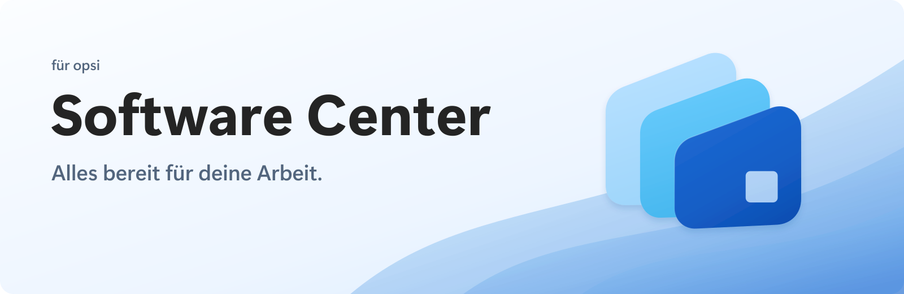

<picture>
  <source media="(prefers-color-scheme: dark)" srcset="docs/branding/soft-stack/banners/readme-banner-dark.png" />
  
</picture>

# Software Center

Leichtgewichtiger, moderner Ersatz für den opsi-client-kiosk: Endanwender installieren,
aktualisieren und entfernen freigegebene Software selbst — ohne Admin-Rechte, ohne Ticket.
Optik und Bedienung orientieren sich am Microsoft Intune Company Portal.

Tauri 2 + Svelte 5 + Tailwind v4 · ~4,4 MB portable EXE · Windows 11 Mica,
automatischer Hell-/Dunkel-Modus.

## Features

- **App-Kacheln** mit Produkt-Icons, Status (Installiert / Update verfügbar) und Suche/Filtern
- **Detailseite pro App**: Beschreibung, Versionen, Abhängigkeiten — installiert wird hier,
  nicht aus der Übersicht
- **Sofortige Ausführung**: Installieren/Aktualisieren/Deinstallieren läuft direkt los
  (setzt den Action-Request und feuert `processActionRequests` für genau dieses Produkt)
- **„X Updates installieren"** Sammelaktion, sobald Updates verfügbar sind
- **Sync** (Footer): holt den Serverstand und führt alle ausstehenden Action-Requests sofort
  aus — z. B. Zuweisungen, die serverseitig über AD-Gruppen-Automatik gesetzt wurden
- **Läuft im Infobereich (System-Tray)**: bleibt dauerhaft per Tray-Icon erreichbar;
  Fenster-Schließen blendet nur in den Tray aus (Beenden ausschließlich über das Tray-Menü),
  Linksklick holt es zurück. Nur eine Instanz gleichzeitig.
- **Autostart beim Anmelden** (standardmäßig an, im Tray minimiert) — abschaltbar unter
  *Info → Einstellungen*
- **Auto-Erkennung + Benachrichtigungen**: 5-Minuten-Hintergrund-Refresh; neue serverseitige
  Zuweisungen und verfügbare Updates melden sich per **nativer Windows-Benachrichtigung**
  (und, bei offenem Fenster, per Toast „Jetzt ausführen")
- **Status-Footer**: Verbindungsstatus + Client-FQDN, Depot, App-Anzahl, letzte Synchronisierung
- **Demo-Modus**: ohne erreichbaren opsiclientd startet ein Mock-Katalog (gelber Punkt im
  Footer); kompletter UI-Flow testbar, `OPSI_KIOSK_MOCK=1` erzwingt ihn

Logo, App-Icons und Banner: [Soft-Stack-Branding](docs/branding/soft-stack/README.md).

## Wie es funktioniert

Die App spricht die **lokale Kiosk-API des opsiclientd** an — dieselbe Schnittstelle, die der
offizielle opsi-client-kiosk verwendet:

```
https://localhost:4441/kiosk   (JSON-RPC, unauthentifiziert von localhost)
```

| Methode | Zweck |
|---|---|
| `getClientId` | opsi-Client-ID dieses Rechners |
| `getConfigDataFromOpsiclientd` | Depot-ID, opsiclientd-Version |
| `getKioskProductInfosForClient` | Produktkatalog + Installationsstatus |
| `setProductActionRequestWithDependencies` | setup/uninstall setzen (inkl. Abhängigkeiten) |
| `processActionRequests` | Action-Requests sofort ausführen (ohne Liste: alle) |

Fortschritt wird durch Re-Polling der Produktinfos beobachtet (5 s-Intervall, solange
Requests offen sind). Abschluss-Toasts nennen die betroffenen Produkte.

## Voraussetzungen auf dem Client

1. **opsi-client-agent 4.3** (opsiclientd-Dienst läuft)
2. **Kiosk-API aktiv** — Standard (`opsiclientd.conf` → `[control_server]` →
   `kiosk_api_active = true`)
3. **Software-on-Demand konfiguriert** (serverseitig): Produktgruppe(n) anlegen und
   `software-on-demand.product-group-ids` darauf zeigen lassen; Event `on_demand` aktiv
4. **WebView2-Runtime** (auf Windows 11 vorhanden)

Keine Admin-Rechte, keine Zugangsdaten: Die Kiosk-API ist von localhost erreichbar und
zeigt ausschließlich die per Software-on-Demand freigegebenen Produkte.

## Produkt-Icons

Die Kiosk-JSON-RPC-API liefert **keine** Icons. Die App sucht `<productId>.png`
(auch `.ico/.jpg/.svg/.webp`) in dieser Reihenfolge:

1. `OPSI_KIOSK_ICON_DIR` (Umgebungsvariable)
2. `%ProgramData%\opsi-kiosk\icons\` ← **befüllt das opsi-Paket bei der Installation**
3. `icons\` neben der EXE
4. lokale opsi-client-kiosk-Installation (`ock_custom\product_icons`)
5. Depot-Share `\\<depot>\opsi_depot\opsi-client-kiosk\files\app\ock_custom\product_icons\`

Anders als beim alten Kiosk ist **keine `IconsList.txt` nötig** — Dateiname = Produkt-ID.
Ohne Icon erscheint ein generisches Paketsymbol.

## Deployment (opsi-Paket)

Paketquellen unter [`deploy/opsi/`](deploy/opsi/README.md) — Localboot-Produkt
`software-center` mit NSIS-Silent-Install (perMachine, SYSTEM-tauglich), Fast-Exit über die
Uninstall-Registry (enforce-/Self-Healing-tauglich), Icon-Provisionierung und
Startmenü-Eintrag ohne Desktop-Link.

```powershell
.\deploy\build-opsi-package.ps1   # sammelt den Installer ein
# dann: deploy/opsi → opsi-Server, opsi-makepackage, opsi-package-manager -i
```

## Entwicklung

```powershell
pnpm install
pnpm tauri:dev      # App mit Hot-Reload (Demo-Modus ohne opsiclientd)
pnpm check          # svelte-check
pnpm tauri:build    # Release: portable EXE + NSIS-Setup + MSI
```

Architektur-Details und Konventionen: [`CLAUDE.md`](CLAUDE.md).

## Sicherheit

- Nur lokale Kiosk-API — sichtbar/auslösbar ist ausschließlich, was serverseitig per
  Software-on-Demand freigegeben wurde
- TLS-Prüfung ist nur für `localhost:4441` deaktiviert (selbstsigniertes
  opsiclientd-Zertifikat); es wird nie ein entfernter Host kontaktiert (Ausnahme:
  lesender Icon-Zugriff auf den Depot-Share)
- Produkt-IDs werden vor Pfad-Verwendung (Icon-Lookup) gegen Traversal gefiltert
