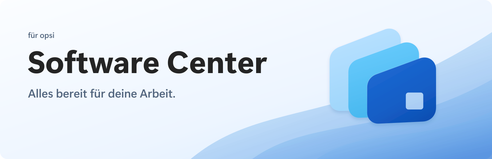

# Software Center · Soft Stack

Das fertige Branding basiert auf der ausgewählten [Konzepttafel **02 Soft Stack**](reference.png): drei gestaffelte blaue App-Karten, weiche Rundungen und ein quadratischer Ausschnitt in der vorderen Karte. Der Produktname bleibt **Software Center**, der Claim **„Alles bereit für deine Arbeit.“**

[Branding ansehen](index.html) · [Komplettes Paket herunterladen](../soft-stack-branding.zip)



## Die wichtigsten Dateien

| Einsatz | SVG | PNG / weitere Formate |
| --- | --- | --- |
| Farbiges Zeichen, transparenter Hintergrund | [mark.svg](svg/mark.svg) | [1024 px](png/mark/1024.png), [2048 px](png/mark/2048.png) |
| Flächiges Zeichen ohne Verläufe | [mark-flat.svg](svg/mark-flat.svg) | [1024 px](png/mark-flat/1024.png) |
| Einfarbiges Zeichen | [Dunkel](svg/mark-mono-dark.svg), [Weiß](svg/mark-mono-light.svg), [Blau](svg/mark-mono-blue.svg) | Ordner `png/mark-mono-*` |
| Logo nebeneinander | [Dunkle Schrift](svg/logo-horizontal.svg), [Weiße Schrift](svg/logo-horizontal-inverse.svg) | [Normal](png/logo-horizontal.png), [2×](png/logo-horizontal@2x.png) |
| Logo untereinander wie auf der Konzepttafel | [Dunkle Schrift](svg/logo-stacked.svg), [Weiße Schrift](svg/logo-stacked-inverse.svg) | [Normal](png/logo-stacked.png), [2×](png/logo-stacked@2x.png) |
| Reine Wortmarke | [Dunkel](svg/wordmark.svg), [Weiß](svg/wordmark-inverse.svg) | Ordner `png/` |
| App-Icon mit heller Trägerfläche | [app-icon.svg](svg/app-icon.svg) | [1024 px](png/app-icon/1024.png), [2048 px](png/app-icon/2048.png) |
| App-Icon mit dunkler Trägerfläche | [app-icon-dark.svg](svg/app-icon-dark.svg) | [1024 px](png/app-icon-dark/1024.png) |
| README-Banner | [Hell](banners/readme-banner.svg), [Dunkel](banners/readme-banner-dark.svg) | [Hell](banners/readme-banner.png), [Dunkel](banners/readme-banner-dark.png), jeweils auch als 2×-PNG |
| Social-/Repository-Vorschau | [1200 × 630](social/social-preview.svg) | [PNG](social/social-preview.png) |
| Native App-Icons | — | [Windows ICO](icons/icon.ico), [macOS ICNS](icons/icon.icns), Windows-Kacheln sowie iOS-/Android-Exporte |
| Favicon / kleines freistehendes Zeichen | [mark.svg](svg/mark.svg) | [ICO mit sieben Größen](icons/favicon.ico), [16 px](png/mark/16.png), [32 px](png/mark/32.png) |

**Zeichen und App-Icons:** 16, 24, 32, 48, 64, 128, 256, 512, 1024 und 2048 px. PNG-Dateien behalten echte Transparenz. Die Wortmarken in SVG und Bannern bestehen aus Pfaden; dafür muss auf dem Zielgerät keine Schrift installiert sein. Die SVGs enthalten keine eingebetteten Rasterbilder und keine externen Ressourcen.

## Nähe zur Vorlage

Die Farbversion verwendet die Konturen des großen Logos links oben auf der ausgewählten Konzepttafel. Die drei Karten wurden in deren Koordinaten nachgezeichnet; Rundungen, Überlappung, Versatz und Ausschnitt stammen aus dieser Vorlage. Die weichen Verläufe sind als editierbare SVG-Verläufe angelegt. Die native Icon-Version ergänzt die helle, abgerundete Trägerfläche aus dem App-Icon-Beispiel unten links.

Die Konzepttafel ist ein generiertes Rasterbild und enthält leicht unterschiedliche Darstellungen des Zeichens. Deshalb ist das große Logo die verbindliche Form für alle Exporte. Materialkörnung und kleine Abweichungen zwischen den Tafelfeldern werden nicht als zusätzliche Formen übernommen. Die Reinzeichnung ist vorlagengetreu, aber kein pixelidentischer Ausschnitt aus dem Rasterbild.

## Farben und Schrift

| Rolle | Wert |
| --- | --- |
| Primärblau | `#185ABD` |
| Helles Blau | `#69C6F3` |
| Heller Hintergrund | `#F5F7FB` |
| Dunkle Schrift | `#242424` |
| Weiß | `#FFFFFF` |
| Dunkler Hintergrund | `#14233B` |

Die Materialverläufe enthalten zusätzliche Helligkeitsstufen derselben Blaufamilie. [tokens.json](tokens.json) und [tokens.css](tokens.css) enthalten die Basisfarben und Typografieangaben.

UI-Schrift: **Segoe UI Variable**, danach Segoe UI, system-ui, sans-serif. Überschriften verwenden 600, die Wortmarke 700. Die Wortmarke ist in Pfade umgewandelt; Schriftdateien werden nicht mitgeliefert. Die Anwendung respektiert weiterhin die Windows-Akzentfarbe. Die Produktidentität bleibt dabei blau.

## Verwendung

- Den freien Abstand um das Zeichen mindestens so groß wie die Breite seines quadratischen Ausschnitts halten.
- Ab 16 px das freistehende Zeichen verwenden; bei kleinen Darstellungen auf einen klar erkennbaren Ausschnitt achten.
- Auf hellen Flächen die dunkle Wortmarke, auf dunklen Flächen die inverse Wortmarke verwenden.
- Für einfarbige Darstellungen die bereitgestellten Mono-Dateien einsetzen. Deren kleine Trennfugen erhalten die drei sichtbaren Karten.
- Kartenreihenfolge, Proportionen, Ausschnitt und Winkel beibehalten. Das Zeichen nicht strecken, drehen oder zusätzlich umranden.

## Im Projekt eingebunden

- Der Projekt-README verwendet das passende helle bzw. dunkle PNG-Banner.
- `app-icon.png`, `src/assets/icon.png` und `src/assets/icon.svg` sind aktualisiert.
- `src-tauri/icons/` enthält die neu exportierten nativen Icons; Fenster, Taskleiste und Installer verwenden sie über die Tauri-Icon-Anbindung.
- Der Infobereich (Tray) zeigt gemäß der 16-px-Regel das freistehende Zeichen ohne Trägerfläche: `src-tauri/icons/tray.png` (Kopie von `png/mark/32.png`, scharf bis 200 % Skalierung).
- In der App steht das Zeichen (`src/assets/mark.svg`) mit dem Produktnamen oben im Navigationsbereich.
- Die Fallback-Akzentfarbe (wenn die Windows-Akzentfarbe nicht lesbar ist) ist das Primärblau `#185ABD`.
- Das Browser-Favicon verwendet das freistehende SVG-Zeichen.

## Quellen und erneuter Export

`source/build.py` erzeugt alle SVGs und Design-Tokens aus einer gemeinsamen Zeichengeometrie und den gespeicherten Schriftpfaden. Dafür genügt Python 3. Der Export erzeugt keine neue KI-Interpretation.

```powershell
python source/build.py
node source/export.mjs
```

Der PNG-Export benötigt Node.js und `sharp`. Falls das Paket an anderer Stelle installiert ist, akzeptiert `export.mjs` als erstes Argument das Verzeichnis, unter dessen `node_modules` es liegt. `source/extract-type.py` erneuert bei Bedarf die gespeicherten Schriftpfade mit FontTools und einer lokal installierten Segoe UI Variable.

Die nativen Icon-Sets werden im Repository mit dem vorhandenen Tauri-Werkzeug erzeugt:

```powershell
pnpm exec tauri icon docs/branding/soft-stack/png/app-icon/1024.png --output docs/branding/soft-stack/icons
```

Die unveränderte ausgewählte Konzepttafel liegt als [reference.png](reference.png) bei.
